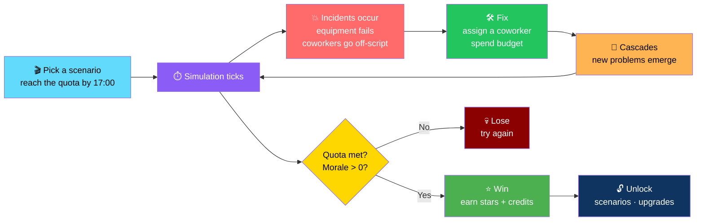
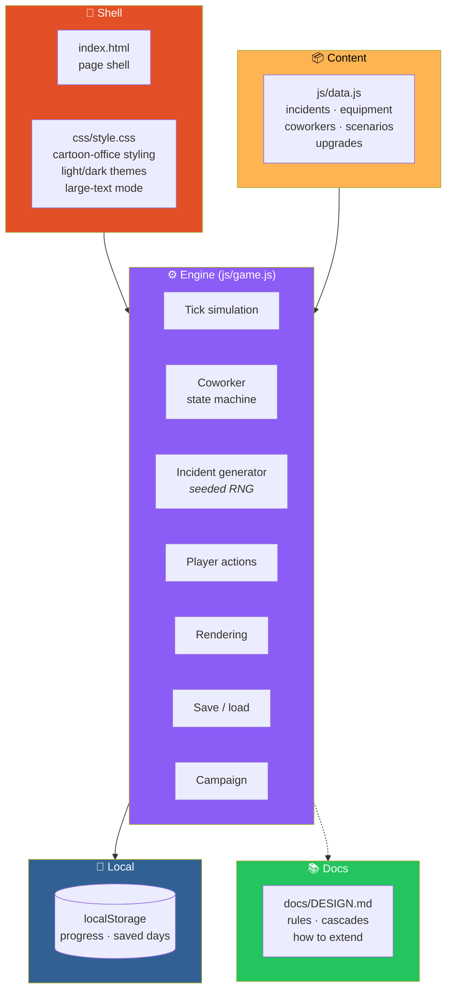

# 🏢 Office Disaster Simulator

<div align="center">


**Keep a dysfunctional office running while every fix risks creating new problems.**

*A humorous workplace simulation — fully local, no server, no build step, no dependencies.*

[🚀 Run It](#-run-it) • [🎮 How to Play](#-how-to-play) • [🏗️ Architecture](#️-architecture) • [📚 Design Doc](#-design-doc) • [⚠️ Not Included](#-not-included)

</div>

---

## 📖 Overview

**Office Disaster Simulator** is a **humorous workplace simulation**.

You keep a **dysfunctional office** running — while **every fix risks creating new problems**.

### Core Idea

> **Every solution is a new problem.**
>
> Hire help, spend budget, investigate recurring failures — and still miss the 17:00 quota because the printer caught fire again.

> ✅ **Single-player web version. Runs fully locally — no server, no build step, no dependencies.**

### The Loop



---

## 🚀 Run It

### Option 1 — Double-Click

**Double-click `index.html`.**

### Option 2 — Serve the Folder

```bash
python3 -m http.server 8000
```

Then open **http://localhost:8000**.

### 💾 Persistence

> **Progress and saved days are stored in your browser** *(localStorage)*.
>
> **Use "Reset progress" in the menu to clear them.**

---

## 🎮 How to Play

### 🎯 The Objective

**Pick a scenario. Reach the document quota by 17:00 without morale hitting zero.**

### 🖱️ The Controls

<div align="center">

| Action | How |
|--------|-----|
| **Select a coworker** | Click them in the office view |
| **Assign a solution** | Press a solution to assign the selected coworker |
| **Auto-assign** | **Leave nobody selected** and press a solution |
| **Spend budget** | On supplies · overtime · emergency meetings |
| **Investigate** | Recurring failures become **rarer** |
| **Pause** | **Space** |
| **Speed** | **1× · 2× · 4×** |

</div>

### 🏆 Winning

**Win to:**

- **Earn stars and credits**
- **Unlock scenarios**
- **Buy permanent upgrades**

### 🎬 What to Watch

- **Incidents** — things going wrong
- **Equipment** — things that break
- **Coworkers** — people with their own state machine
- **Morale** — the resource you must not let hit zero

---

## 🏗️ Architecture

### System Overview



### 📂 File Structure

```
office-disaster-simulator/
├── index.html        Page shell, loads the CSS and scripts
├── css/
│   └── style.css     Cartoon-office styling
│                     light/dark themes
│                     large-text mode
│
├── js/
│   ├── data.js       Content: incidents, equipment
│   │                 coworkers, scenarios, upgrades
│   └── game.js       Engine:
│                     · tick simulation
│                     · coworker state machine
│                     · incident generator
│                     · player actions
│                     · rendering
│                     · save/load
│                     · campaign
│
├── docs/
│   └── DESIGN.md     How the rules and cascades work
│                     and how to extend the game
│
└── README.md
```

### Design Principles

<div align="center">

| Principle | Implementation |
|-----------|---------------|
| **📦 Content is data** | Incidents, equipment, coworkers, scenarios, and upgrades live in `js/data.js` — **the engine reads, it doesn't hard-code** |
| **⚙️ Engine is separate** | `js/game.js` owns the tick simulation, state machine, incident generation, actions, rendering, save/load, and campaign |
| **🎲 Seeded randomness** | Incident rolls use **mulberry32** — the same seed produces the same sequence, **which makes the simulation reproducible and portable** |
| **🧠 Coworkers have state machines** | They aren't scripted animations — they react to incidents and to their own limits |
| **🔀 Cascades are the game** | **Every fix risks creating new problems** — a cascade is a feature, not a bug |
| **💾 Local saves** | Progress lives in `localStorage` — reset from the menu |
| **🔌 Portable by design** | The seeded generator is **a good starting point for porting the simulation to a Go package** |
| **📚 Documentation included** | `docs/DESIGN.md` explains the rules, the cascades, and how to extend the game |

</div>

---

## 📚 Design Doc

> 📖 **See [`docs/DESIGN.md`](docs/DESIGN.md)** for:
>
> - **How the rules work**
> - **How cascades work**
> - **How to extend the game**

---

## ⚠️ Not Included

> **The spec's optional Go backend** *(REST/WebSocket API, SQLite, Go tests)* **is not part of this build**.

### 🔌 A Note on Porting

> **Incident rolls use a seeded generator (`mulberry32`)** — **a good starting point for porting the simulation to a Go package.**

---

## 🗺️ Roadmap

### ✅ Current

- [x] Fully local single-player web version
- [x] No server, no build step, no dependencies
- [x] Double-click to run, or serve with any static server
- [x] Cartoon-office styling
- [x] Light and dark themes
- [x] Large-text mode
- [x] Data-driven incidents, equipment, coworkers, scenarios, and upgrades
- [x] Tick-based simulation engine
- [x] Coworker state machine
- [x] Incident generator with seeded mulberry32 RNG
- [x] Player actions — assign coworkers, spend budget, investigate failures
- [x] Auto-assign when no coworker is selected
- [x] Cascading consequences — every fix can create new problems
- [x] Budget spending — supplies, overtime, emergency meetings
- [x] Investigation mechanic — recurring failures become rarer
- [x] Scenario selection with document quota and 17:00 deadline
- [x] Morale system — hitting zero ends the run
- [x] Win state with stars and credits
- [x] Scenario unlocking
- [x] Permanent upgrades purchasable with credits
- [x] Pause with Space
- [x] Speed controls — 1×, 2×, 4×
- [x] Save and load progress in localStorage
- [x] Reset progress from the menu
- [x] `docs/DESIGN.md` explaining rules, cascades, and extension
- [x] Seeded generator designed for porting to a Go package

### 🔜 Future Ideas

- [ ] **The optional Go backend** — REST/WebSocket API, SQLite, Go tests
- [ ] **Port the simulation to a Go package** — the seeded generator is already the starting point
- [ ] **Additional scenarios** beyond the current set
- [ ] **Additional incidents, equipment, and coworkers**
- [ ] **Additional permanent upgrades**
- [ ] **Sound effects** — synthesized with Web Audio
- [ ] **Save export and import** — JSON backup
- [ ] **Daily challenge** with a fixed seed
- [ ] **Local leaderboards** — best runs per scenario
- [ ] **Accessibility audit** — beyond large-text mode

---

## 🤝 Contributing

Contributions are welcome. Please:

1. Fork the repository
2. **Keep content in `js/data.js`** — incidents, equipment, coworkers, scenarios, and upgrades are data, not engine code
3. **Keep the engine deterministic when a seed is given** — the seeded generator is what makes the simulation reproducible
4. **Preserve the cascade behavior** — every fix creating new problems is the game
5. **Keep it dependency-free** — no build step, no frameworks
6. **Update `docs/DESIGN.md`** when changing rules or cascades
7. **Preserve localStorage compatibility** without a migration path
8. Test in a browser before submitting
9. Submit a Pull Request

### Guidelines

- **Never add a required server** — the game must run from `index.html`
- **Never hard-code content** that belongs in `js/data.js`
- **Never break the seeded RNG** without updating the porting notes
- **Never remove the large-text mode or theme support**
- **Never present a stub as a feature**

---

## 📜 License

MIT — see [LICENSE](LICENSE) for details.

---

## 🙏 Acknowledgments

- **Every office that's ever had "one of those days"** — this one's for you
- **`mulberry32`** — for making seeded randomness this small and this reliable

---

<div align="center">

### 🏢 FIX ONE THING. BREAK TWO MORE.

**Keep a dysfunctional office running while every fix risks creating new problems.**

**Fully local. No server. No build step. No dependencies.**

<br>

> ⚠️ **The optional Go backend is not included in this build.**

<br>

⭐ If Office Disaster Simulator made you laugh, consider giving it a star.

<br>

[⬆ Back to Top](#️-office-disaster-simulator)

</div>
